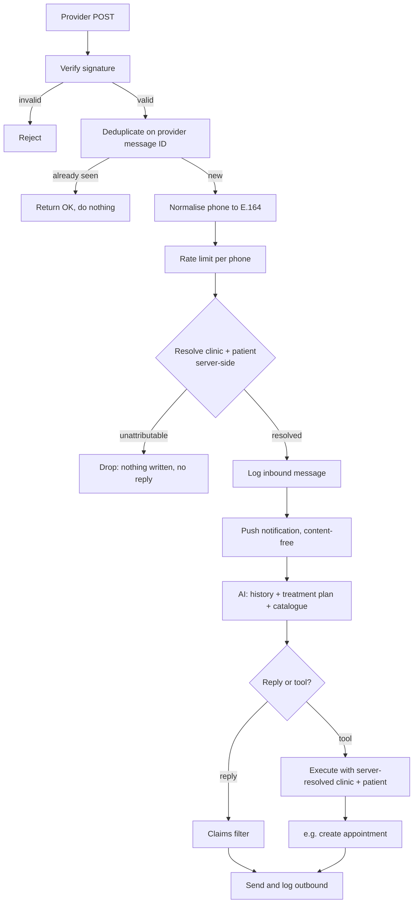

<Warning>
  This endpoint is **public by necessity** — the provider must be able to reach it without a session. It authenticates every request cryptographically instead.

  It is matched **exactly**, never by prefix. `/api/whatsapp` is public; `/api/whatsapp/send` and `/api/whatsapp/inbox` require a session. A prefix rule here would expose both.
</Warning>

## Verification

`GET /api/whatsapp` — provider webhook verification handshake, using a verification token.

## Receiving a message

`POST /api/whatsapp`

Authenticated by a cryptographic signature over the request URL and its sorted parameters. **An unsigned or incorrectly signed request is rejected before it reaches any data.**

## What happens on a valid message

## The properties that matter

<AccordionGroup>
  <Accordion title="Deduplication is a database constraint, not a check" icon="clone" defaultOpen>
    A uniqueness constraint on the provider's message ID is the authority. Providers retry webhooks on any hiccup; a retried delivery **cannot** produce a second AI reply.
  </Accordion>

  <Accordion title="Unattributable messages are dropped, not guessed" icon="circle-question">
    If a message cannot be resolved to a clinic with certainty, **nothing is written and no reply is sent.** Silence beats replying into the wrong clinic's context.
  </Accordion>

  <Accordion title="The AI never chooses whose data it touches" icon="shield">
    Clinic and patient are resolved from the verified sender *before* the model is called, and are passed to any tool execution from that server-side resolution — never from model output.

    Precisely: a prompt injection can choose **which tool runs**. It cannot choose **whose record it runs against**.
  </Accordion>

  <Accordion title="Push notifications are content-free" icon="bell">
    The notification carries a device token and a generic string. Patient name and message content are never in the payload — which is why a notification on a lock screen discloses nothing.
  </Accordion>

  <Accordion title="Inbound is rate-limited per phone number" icon="gauge-high">
    15 per minute per sender. A malfunctioning or hostile sender cannot exhaust a clinic's AI quota.
  </Accordion>
</AccordionGroup>

## AI tool execution

When the model decides to act rather than reply, the tool runs with server-resolved identity. For `book_appointment`:

<Steps>
  <Step title="Parse the requested date and time" />
  <Step title="Find clinicians qualified for the service">
    From the service catalogue. No mapped clinician means no booking — the request escalates instead.
  </Step>
  <Step title="Create the appointment">
    The commit point. Everything after is bookkeeping.
  </Step>
  <Step title="Bookkeeping, each independently fault-tolerant">
    Google Calendar push, reminder queueing, follow-up scheduling. A failure in any one of these does **not** roll back the appointment — a booked patient with a missing calendar entry is far better than a patient told they are booked when they are not.
  </Step>
</Steps>

## Hallucinated-confirmation interception

A reply claiming an appointment that no tool actually created is intercepted before it reaches the patient.

<Note>
  This is the guardrail that matters most in practice. A model that occasionally says "you're booked for Thursday" without booking anything is worse than no automation at all — so that specific failure is checked for explicitly rather than trusted not to happen.
</Note>

## Response semantics

| Situation | Response |
| --- | --- |
| Processed | `200` |
| Duplicate delivery | `200` — treated as success so the provider stops retrying |
| Invalid signature | `403` |
| Rate limited | `429` |
| Unexpected failure | `500`, so the provider retries |
