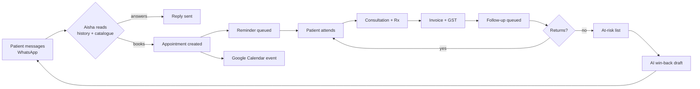

Learn these once and the rest of the product stops surprising you.

<AccordionGroup>
  <Accordion title="Clinic — the tenant boundary" icon="building" defaultOpen>
    Everything in RetAI belongs to exactly one clinic: patients, appointments, invoices, photos, messages, stock. A query can never reach across clinics, and there is no screen anywhere that shows two clinics' patients side by side.

    Multi-location groups get one clinic record per location plus a group-owner account that can switch between them.
  </Accordion>

  <Accordion title="Patient — identified by phone number" icon="user">
    The phone number in E.164 format (`+919876543210`) is the identity key. It is what joins an inbound WhatsApp message, a voice call recording, an invoice, and a photo to the same person.

    This is why the importer normalises numbers and why a manually typed number without a country code causes trouble later.
  </Accordion>

  <Accordion title="Service vs. package" icon="tags">
    A **service** is one procedure at one price — a single laser session, a consultation, a peel.

    A **package** is a bundle of sessions sold together — six laser sessions, valid twelve months, at a package price. RetAI tracks sessions consumed and sessions remaining, and recognises revenue against sessions delivered rather than all at once.

    Sessions remaining is also the strongest signal in at-risk scoring: a patient with four paid sessions left who has not visited in ten weeks is the most valuable call your front desk can make today.
  </Accordion>

  <Accordion title="Appointment — the unit of scheduling" icon="calendar-days">
    An appointment binds a patient, a service, a clinician, a room or resource, and a time. Creating one automatically:

    - queues a reminder for the right moment before the slot
    - pushes an event to the clinician's Google Calendar, if connected
    - schedules a follow-up for after the visit
  </Accordion>

  <Accordion title="Follow-up queue — why messages arrive on time" icon="clock-rotate-left">
    RetAI does not send messages the moment something happens. It writes a row into a follow-up queue with a trigger time, and a worker drains that queue every few minutes.

    The consequence you care about: **a message is never sent twice.** Each queued item is claimed atomically before sending, so overlapping workers cannot double-message a patient. If bookkeeping fails *after* delivery, the row is parked for manual review rather than retried — a duplicate message to a patient is treated as worse than a missing log line.
  </Accordion>

  <Accordion title="Aisha — the AI agent" icon="robot">
    Aisha is the reasoning layer between an inbound patient message and your calendar. She reads recent conversation, the patient's active treatment plan, and your live service catalogue, then either replies or calls a tool such as `book_appointment`.

    Two guardrails are structural, not prompt-level:

    - **Whose data she touches is never her decision.** The clinic and the patient come from the verified message sender on the server. A crafted message can influence what Aisha *says*; it cannot make her read another patient's record.
    - **She cannot confirm what did not happen.** Replies claiming a booking that no tool actually made are intercepted before they reach the patient.
  </Accordion>

  <Accordion title="At-risk score" icon="heart-pulse">
    A ranking, not a label. It weighs time since last visit against that patient's own visit rhythm, unfinished package sessions, lifetime value, and treatment type. A quarterly-maintenance patient at eleven weeks is not at risk; a monthly patient at eleven weeks is.

    The list is sorted by revenue at stake so the front desk works the most valuable call first.
  </Accordion>

  <Accordion title="Roles and modules" icon="lock">
    Every dashboard screen is a **module**. Every role has a set of modules it may open. Owners always see everything and cannot be locked out of their own clinic.

    Access is checked on the server when the page loads, not hidden in the browser — typing the URL of a module you lack access to gets you nothing.
  </Accordion>
</AccordionGroup>

## The daily loop, in one diagram

