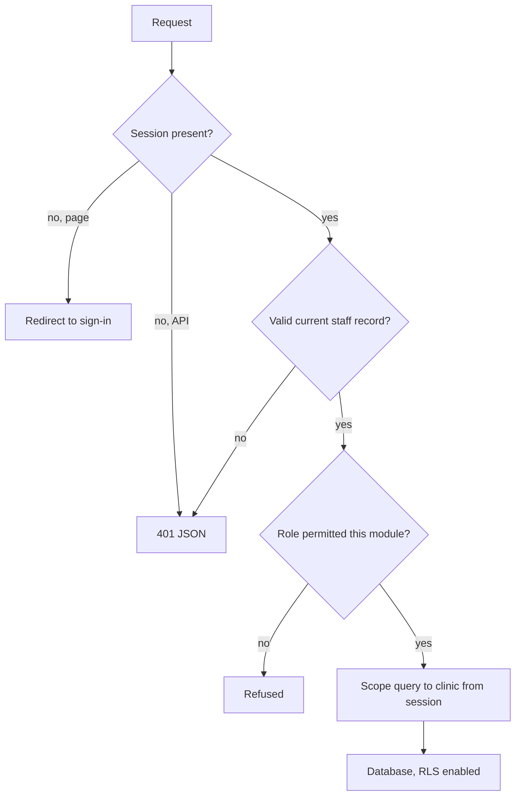

Written for the technically minded evaluator — a clinic's IT advisor, a group's security reviewer, or a developer integrating with the API.

## Request path

Four independent layers, in the order a request meets them:

| Layer | Decides |
| --- | --- |
| Edge | Is there a session at all? |
| Identity | Is this a valid, currently-active staff member? |
| Module access | May this role open this screen? |
| Tenant scope | Which clinic's rows may this query touch? |

## Authentication

Sessions are signed JWTs with an **8-hour idle lifetime**, refreshed on activity.

Two sign-in paths:

- **Google** — the identity is verified by Google, then matched against an existing staff record. There is no self-registration: an unrecognised Google account is rejected outright rather than creating an account.
- **Email and password** — rate-limited per IP address.

Role and clinic are re-read from the staff record periodically rather than trusted from the token for its full lifetime. This is what makes de-provisioning take effect in minutes. **A missing staff record grants nothing** — the failure mode is closed, not open.

## Tenant isolation

The single most important property in the system.

Every table carries a clinic identifier. Every query is scoped to the clinic derived from the authenticated session. Two specific implementation choices matter:

<Warning>
  **Clinic identity is never read from user input.** Not from a URL parameter, not from a request body, not from a webhook payload, not from AI output. It comes from the session, or from a server-side lookup on a verified phone number. Editing an ID in a request cannot reach another clinic's data because the ID in the request is not what the query uses.
</Warning>

<Warning>
  **An unscoped query throws rather than returning everything.** The scoping helper raises an error if it cannot determine a clinic, and writes are refused before they run. A coding mistake that forgets scoping produces a failure, not a leak.
</Warning>

Row-level security is enabled independently on every table holding customer data. Its job is to make a leaked database credential worthless — a second layer that does not depend on the first being correct.

## Structural test coverage

Tenant scoping is not only reviewed, it is tested structurally. A test suite sweeps every API route and every dashboard page for the presence of its authentication guard and session-derived clinic scope. **Adding a route that forgets either one fails the build.**

That is a stronger guarantee than a code-review checklist, because it does not depend on a reviewer noticing.

## Webhook authentication

Public endpoints exist — inbound WhatsApp, voice events, scheduled jobs — and each authenticates itself:

| Endpoint | Mechanism |
| --- | --- |
| WhatsApp inbound | Cryptographic signature over the request URL and parameters |
| Voice events | Shared secret, **fails closed in production** if unconfigured |
| Scheduled jobs | Secret compared in constant time |
| Calendar OAuth callback | Signed, 10-minute-lifetime authorisation state |

Public endpoints are matched **exactly**, never by prefix. This is deliberate: a prefix rule that made the inbound WhatsApp webhook public would also make the send and inbox endpoints public.

## Idempotency

Two places where a duplicate would be visible to a patient are protected at the database level, not in application logic:

- **Inbound messages** — a uniqueness constraint on the provider's message ID. A retried webhook cannot produce a second AI reply.
- **Voice call records** — a uniqueness constraint on the provider's call ID. A retried event cannot produce a duplicate call.

Outbound messages are claimed atomically before sending, so overlapping workers cannot double-message a patient. Where delivery succeeds but bookkeeping fails, the record is parked for manual reconciliation rather than retried — a duplicate message to a patient is treated as worse than a missing log line.

## AI boundary

The model sits inside the request path, never outside the authorisation boundary:

1. The sender is cryptographically verified by the webhook signature
2. Clinic and patient are resolved server-side from that verified sender
3. Only then is the model called, with an allowlisted subset of patient fields
4. The model may choose *which action* to take; it never supplies *whose data* the action runs against
5. Outputs pass a claims filter before delivery

<Note>
  Put precisely: a prompt injection can choose which tool runs. It cannot choose whose record it runs against.
</Note>

## Infrastructure

| Component | Provider |
| --- | --- |
| Application hosting | Vercel |
| Database and storage | Supabase (PostgreSQL) |
| WhatsApp delivery | Twilio, over the Meta WhatsApp Business Platform |
| AI language processing | Google Gemini |
| Voice | Bolna |
| Push notifications | Firebase Cloud Messaging |

Full disclosure including data categories and processing locations: [Subprocessors](/security/subprocessors).

## Known limitations

We publish these rather than waiting to be asked:

1. **Invoice creation is not a single atomic transaction.** A failure mid-write can leave a partially built invoice. Logged and reconcilable.
2. **Rate limiting is per-instance.** The effective ceiling scales with running instances. Abuse protection, not a hard cap.
3. **Backups age out on rotation.** Data deleted from primary storage persists in encrypted backups until they rotate. See [Retention & deletion](/security/retention-and-deletion).
